# 1. What we are looking for

*Part 1 of the primer series ([index](README.md)). There is no astronomy background assumed: if
you can read a graph and know what a percentage and a square root are, you have everything you
need.*

This project goes through measurements of a few thousand stars and tries to find planets
around them that nobody has noticed yet. This article explains what such a planet "looks
like" in the data, how a computer can find it in noisy measurements, what else can produce the
same look, and how we tell them apart. The later articles explain how each of those steps is
done in practice.

**Contents**

- *The signal:* [1.1 We never see the planet](#11-we-never-see-the-planet) ·
  [1.2 The depth tells us the size](#12-the-depth-tells-us-the-size) ·
  [1.3 The duration tells us about the orbit](#13-the-duration-tells-us-about-the-orbit) ·
  [1.4 Why most planets are invisible](#14-why-most-planets-are-invisible-to-this-method) ·
  [1.5 Where the measurements come from](#15-where-the-measurements-come-from)
- *Finding it:* [1.6 Noise](#16-noise-what-the-measurements-really-look-like) ·
  [1.7 Folding](#17-folding-stacking-the-dips-on-top-of-each-other) ·
  [1.8 The search](#18-the-search-trying-every-possible-period) ·
  [1.9 How strong is strong enough?](#19-how-strong-is-strong-enough)
- *Impostors:* [1.10 Things that look like a planet but are not](#110-things-that-look-like-a-planet-but-are-not) ·
  [1.11 Already known?](#111-already-known)
- *Putting it together:* [1.12 Portrait of a likely planet](#112-portrait-of-a-likely-planet) ·
  [1.13 From the "what" to the "how"](#113-from-the-what-to-the-how) · [Glossary](#glossary)

---

## 1.1 We never see the planet

Planets around other stars (*exoplanets*) are far too small, dark and close to their star to
be photographed directly, apart from a few exceptions. What we *can* measure very precisely
is **how much light a star sends us**, again and again, for weeks.

If a planet's orbit happens to be lined up so that, seen from Earth, it passes in front of its
star, it blocks a small part of the star's light while it crosses. For a couple of hours the
star looks slightly dimmer, and then it returns to normal. This is called a **transit**.

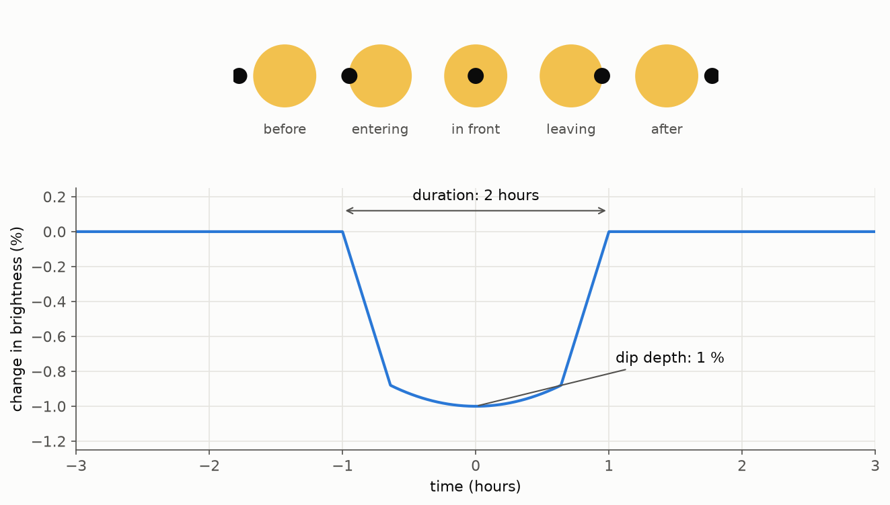

*Top: the star as seen from Earth while the planet (black dot) crosses it. Bottom: the
brightness we measure over time. The numbers are typical of what we look for in this
project.*

Two numbers describe a single dip:

- **Depth**: by how much the star dims (here 1 %).
- **Duration**: how long the dimming lasts (here 2 hours).

A third number only appears when the dip repeats:

- **Period**: the time between two dips, that is, how long the planet takes to go once
  around its star (its "year").

A graph of a star's brightness over time is called a **light curve**. Everything in this
project is about light curves.

### Three things to notice in the shape

1. **The sides are steep, the bottom is wide.** The planet enters the star's disc quickly
   (the sloping sides), then spends most of the transit fully inside it (the bottom).
2. **The bottom is slightly rounded, not perfectly flat.** A star is a little brighter at its
   centre than at its edge (*limb darkening*), so the planet blocks a bit more light when it
   is in the middle.
3. **Before and after the dip, the brightness is the same.** The planet does not change the
   star; it only hides a piece of it for a while.

---

## 1.2 The depth tells us the size

Seen from Earth, the star is a bright disc and the planet is a small black disc on top of it.
The planet gives off essentially no light of its own (it is far colder than the star). So the
fraction of light we lose is the fraction of the star's disc that the planet covers:

> depth = (area of the planet's disc) ÷ (area of the star's disc)

The area of a disc of radius r is π r², so:

> depth = π R_planet² ÷ π R_star² = **(R_planet ÷ R_star)²**

The square is there because **area grows like the square of the width**. A planet 10 times
narrower than its star covers 10 × 10 = 100 times less area, so it blocks 1 % of the light.
Think of a 10 × 10 grid of tiles drawn over the star: the planet covers one tile out of 100.

(This assumes the star is equally bright everywhere on its disc. It is brighter at the
centre, as mentioned above: for a red dwarf, a planet crossing the middle blocks about 15 %
more light than the formula says, and one crossing near the edge less. The pipeline takes
that into account; for this article we ignore it.)

Some examples:

- Earth in front of the Sun: Earth is about 1/109 of the Sun's width, so the depth is
  (1/109)² ≈ 0.008 %. That is 8 parts in 100,000, very hard to measure.
- The same Earth in front of a star 40 % as wide as the Sun: Earth is now 1/44 of the star's
  width, so (1/44)² ≈ 0.05 %, six times easier.
- Jupiter (11 times wider than Earth) in front of that small star: about 6.6 %.

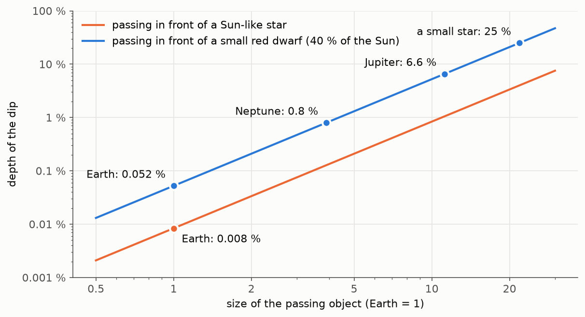

*The same planet makes a much deeper dip around a small star. Both axes go up in factors of
10 so that Earth and Jupiter fit on the same graph.*

This is why **this project looks only at small, cool stars called red dwarfs (or M dwarfs)**.
They are the most common stars in our neighbourhood, and an Earth- or Neptune-size planet
around one makes a dip we can actually measure. We also keep only stars closer than about
330 light-years (100 *parsecs*), because closer stars look brighter, and brighter stars give
cleaner measurements (section 1.6 explains why).

**Turning it around**, if we know the star's size (from star catalogues) and measure the depth,
we get the planet's size by taking the square root:

> R_planet = R_star × √depth

Example: a 0.5 % dip (0.005) on a star 40 % as wide as the Sun. √0.005 ≈ 0.071, so the
planet is 7.1 % of the star's width. The star is 0.4 × 109 ≈ 44 Earth widths, so the planet is
about 0.071 × 44 ≈ 3.1 times as wide as Earth: a little smaller than Neptune.

Depths are often written in **ppm** (parts per million): 1 % = 10,000 ppm, so 0.5 % =
5,000 ppm.

---

## 1.3 The duration tells us about the orbit

How long the dip lasts is not arbitrary. It depends on how fast the planet moves and how far
it has to travel across the star.

- **Distance to cross**: if the planet passes through the middle of the star, it travels about
  one star diameter, 2 × R_star.
- **Speed**: in a circular orbit of radius a, the planet travels the circumference 2π a in
  one period P, so its speed is 2π a ÷ P.

Duration = distance ÷ speed, so:

> duration ≈ 2 R_star ÷ (2π a ÷ P) = **(P ÷ π) × (R_star ÷ a)**

We still need the orbit's radius a. It is fixed by the star's mass and the period through
**Kepler's third law**, discovered in 1619 for the planets around the Sun. In convenient
units (a in *astronomical units*, the Earth-Sun distance; the star's mass M in Suns; P in
years):

> **a³ = M × P²**

Check with the Earth: M = 1, P = 1, so a = 1. Heavier stars pull harder, so a planet at the
same distance goes round faster.

**Worked example.** A red dwarf with 40 % of the Sun's mass and 40 % of its radius, and a
planet with a period of 3 days (0.0082 years):

1. a³ = 0.4 × 0.0082² ≈ 0.000027, so a ≈ 0.030 astronomical units. That is about 16 times
   the star's radius: the planet is very close to its star (Mercury orbits the Sun 13 times
   farther out).
2. duration ≈ (3 days ÷ π) × (1 ÷ 16) ≈ 0.059 days ≈ **1.4 hours**.

For comparison, the Earth takes about 13 hours to cross the Sun. A planet that crosses closer
to the star's edge travels a shorter chord, so its dip is shorter; **it can be shorter than
this calculation, but not much longer**. Only two things make it somewhat longer: an
elongated (eccentric) orbit that happens to put the transit at the slow, far end of the orbit
(about 35 % longer for a moderately elongated orbit), and errors in the catalogue size and
mass of the star. Section 1.10 uses this as a test.

---

## 1.4 Why most planets are invisible to this method

### Only orbits seen almost edge-on give a transit

The orbits of other planetary systems are tilted at random. A transit only happens if, seen
from Earth, the planet's path crosses the star's disc.

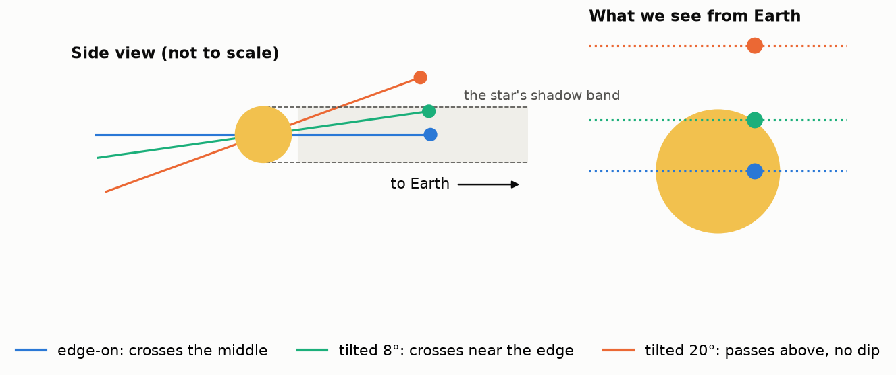

*Left: the planetary system seen from the side, with the Earth far away to the right. The
planet is drawn at the moment it is closest to our line of sight. Right: what we see from
Earth: the planet's path across (or above) the star's disc. Real orbits are 10 to 200 times
wider than the star, which makes the allowed tilt much smaller than in this drawing.*

If the orbit is tilted by an angle θ away from edge-on, then when the planet passes between
the star and us it is at a height a × sin θ above the star's centre (a is the orbit's
radius, as in section 1.3). It crosses the star only if that height is less than the star's
radius:

> transit happens if a × sin θ < R_star

**How likely is that for a random orbit?** Picture an arrow sticking out of the orbit's plane
(the orbit's "axis"). For an edge-on orbit the arrow is perpendicular to our line of sight;
tilting the orbit by θ tilts the arrow by θ as well, and sin θ measures how much the arrow
leans towards (or away from) us. Random orbits mean this arrow points in a random direction in
space, like a random point on a globe.

There is a classic geometry fact, known since Archimedes: **on a sphere, every horizontal band
of the same height has the same area**, whether it is near the equator or near a pole. (Near
the poles the bands are narrower around, but they are also more slanted, and the two effects
cancel exactly.) So the "lean towards us" of a random arrow is equally likely to be any number
between −1 and 1. The condition sin θ < R_star ÷ a picks out a band of total height 2 × R_star
÷ a out of a total of 2, so:

> **probability of a transit = R_star ÷ a**

For the same red dwarf as in section 1.3 (40 % of the Sun's size and mass):

| planet's period | orbit radius ÷ star radius | chance its orbit is aligned |
|---|---|---|
| 1 day | 8 | 13 % |
| 3 days | 16 | 6 % |
| 10 days | 36 | 3 % |
| 30 days | 75 | 1.3 % |
| Earth around the Sun (for comparison) | 215 | 0.5 % |

So even if *every* red dwarf had a planet with a 3-day period, only about **1 in 16** of them
would show transits. For every transiting planet there are many more that we cannot see at all.

### Even an aligned planet can be missed

On top of the alignment, three more things have to go right:

1. **Enough dips in the data.** One TESS observation lasts 27 days (section 1.5). We need at
   least two dips to know the signal repeats and to measure the period, so in practice we only
   find planets with periods below about 12 days. A planet with a 30-day period shows at most
   one dip per observation.
2. **A dip deep enough compared with the noise.** Each measurement has some random error
   (section 1.6). An Earth-size planet around our typical red dwarf makes a 0.05 % dip, while a
   single 10-minute measurement of a typical star in our list wobbles by about 0.3 %. Even
   adding up all its dips in 27 days, such a planet stays hidden in the noise except around the
   brightest stars (we will make this precise in section 1.9).
3. **The star must be in the part of the sky TESS is observing**, and bright enough for a
   ready-made light curve to exist.

Two consequences:

- **Not finding anything around a star does not mean it has no planets.** It only means it has
  no planet that is aligned, close-in and big enough.
- What we find is biased towards **large planets on short orbits**. Article 8 measures exactly
  which planets our pipeline can and cannot find, by hiding fake ones in real data.

---

## 1.5 Where the measurements come from

The data come from **TESS** (the *Transiting Exoplanet Survey Satellite*), a NASA space
telescope launched in 2018. TESS points its four cameras at a long strip of sky for about
**27 days**, takes a picture every few minutes, and then moves on to the next strip. Each
27-day stretch is called a **sector**. Over the years TESS has covered almost the whole sky,
and many stars have been observed in several sectors.

Teams at NASA and MIT turn the pictures into ready-made light curves: one brightness value
per star every 2, 3⅓ or 10 minutes. We download those, so we only handle the pictures
themselves at the very end, to check which star a dip really comes from (section 1.10,
impostor 4).

Two consequences of the 27-day window:

- To see a dip **twice**, the period must be shorter than half the length of the data. This
  project searches for planets with periods between about 5 hours (0.2 days) and half of each
  light curve's length, about 12 days once the gaps and unreliable edges are removed. That
  sounds very short, but around small, cool stars this is where many planets are. Around the
  very smallest and dimmest red dwarfs, a planet in this range can even be at a comfortable
  temperature (for a typical star of our list, 40 % of the Sun's mass, that takes a period of
  a month or more).
- TESS stops several times per sector to send its data to Earth. Every light curve has gaps,
  the longest one in the middle (in sector 104 it lasts about three days; you will see a
  one-day gap in the graphs below).

---

## 1.6 Noise: what the measurements really look like

The graph in section 1.1 is an idealised drawing. Real measurements never fall exactly on a
smooth line. Each one is the true brightness plus a small random error, the **noise**. Before
we can look for a dip, we need to understand what the noise does, because the whole difficulty
of the project is telling a small real dip apart from noise.

### Where the noise comes from

Light arrives as individual particles, photons. A camera measures brightness by counting how
many photons hit its pixels during an exposure. Even for a perfectly steady star, that count
varies from one exposure to the next, the same way the number of raindrops falling on a tile
varies from one minute to the next in steady rain.

This kind of counting has a simple rule: **if you expect N photons, the actual count typically
differs from N by about √N**. So the *relative* error is √N ÷ N = 1 ÷ √N:

| photons per exposure | typical error | relative error |
|---|---|---|
| 10,000 | 100 | 1 % |
| 1,000,000 | 1,000 | 0.1 % |
| 100,000,000 | 10,000 | 0.01 % |

A brighter star sends more photons, so its measurements are relatively cleaner. That is why we
prefer nearby (bright-looking) stars.

### The bell curve and the "spread" σ

If we measure a perfectly steady star many times and draw a histogram of how far each
measurement falls from the true value, we get the famous **bell curve** (also called the
*normal* or *Gaussian* distribution).

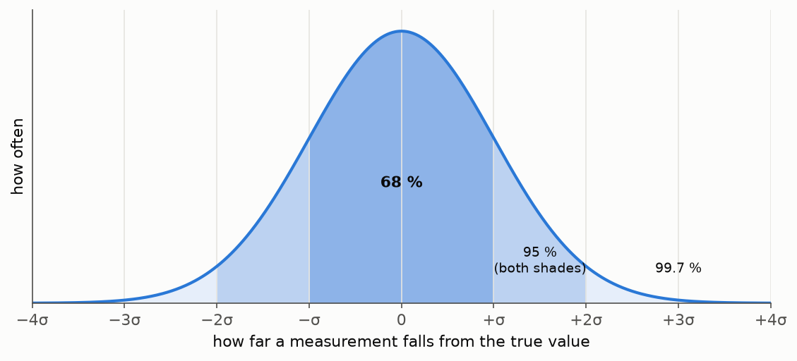

*The width of the bell is measured by one number, the spread σ (the Greek letter sigma, called
the "standard deviation" in statistics). Most measurements are within one σ of the truth;
large deviations are rare, and get rare very fast.*

The bell curve tells us exactly how rare a large deviation is. The chance that one measurement
comes out **below** the truth by more than:

| deviation | chance (one measurement) | roughly |
|---|---|---|
| 1 σ | 16 % | 1 in 6 |
| 2 σ | 2.3 % | 1 in 44 |
| 3 σ | 0.13 % | 1 in 740 |
| 5 σ | 0.000029 % | 1 in 3.5 million |
| 7 σ | 0.00000000013 % | 1 in 800 billion |

Keep these numbers in mind: they are how we will decide whether a dip is real (section 1.9).
For the realistic examples in this article we use σ = 0.3 % per 10-minute measurement, typical
of the stars in our list.

### Averaging shrinks the noise, by √N

Noise has a crucial property: for a steady star, **each error is independent of the others**.
A measurement that came out high tells you nothing about the next one. When we average N
measurements, the positive and negative errors partly cancel.

How much do they cancel? Think of flipping 100 coins and counting heads minus tails. Each coin
adds +1 or −1. You almost never get +100; the typical result is around ±10, that is √100. The
same happens with measurement errors: the *sum* of N independent errors of size σ is typically
√N × σ, not N × σ. The *average* is the sum divided by N, so:

> **spread of an average of N measurements = σ ÷ √N**

Now apply this to a planet whose dip is 0.6 % deep and lasts 2 hours, with measurements every
10 minutes and σ = 0.3 %:

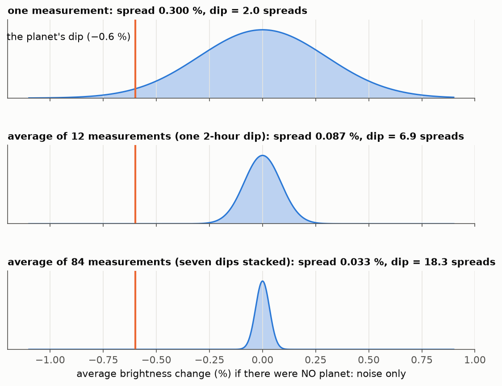

*Each bell shows what the average would look like from noise alone, with no planet. The orange
line is where a 0.6 % dip puts the average. With one measurement, the dip is well inside the
bell: noise could easily do that. Averaging the 12 measurements of one dip makes the bell 3.5
times narrower (√12 ≈ 3.5). Averaging seven dips (84 measurements) makes it 9 times narrower
(√84 ≈ 9.2), and the dip is now 18 spreads away: noise essentially never does that.*

This is the single most important idea of the project: **a dip too small to see in any single
measurement becomes obvious once we average enough measurements taken during dips.**

### Signal versus noise

| | the planet's dip (signal) | random noise | slow wiggles (see below) |
|---|---|---|---|
| direction | always down | up or down equally | up or down |
| repeats | at exactly the same interval | never | not regularly |
| shape and depth | the same every time | different every time | different every time |
| averaging many | stays the same | shrinks like 1 ÷ √N | shrinks slowly, or not at all |

### Not all noise is that friendly

The √N rule only works if the errors are independent. Some variations are not: the star's
spots, slow drifts of the camera, scattered light. They push many measurements in a row in the
same direction. Statisticians call independent noise **white** and this slow, correlated
variation **red** (by analogy with light: white light mixes all frequencies equally, red light
is dominated by slow, low frequencies).

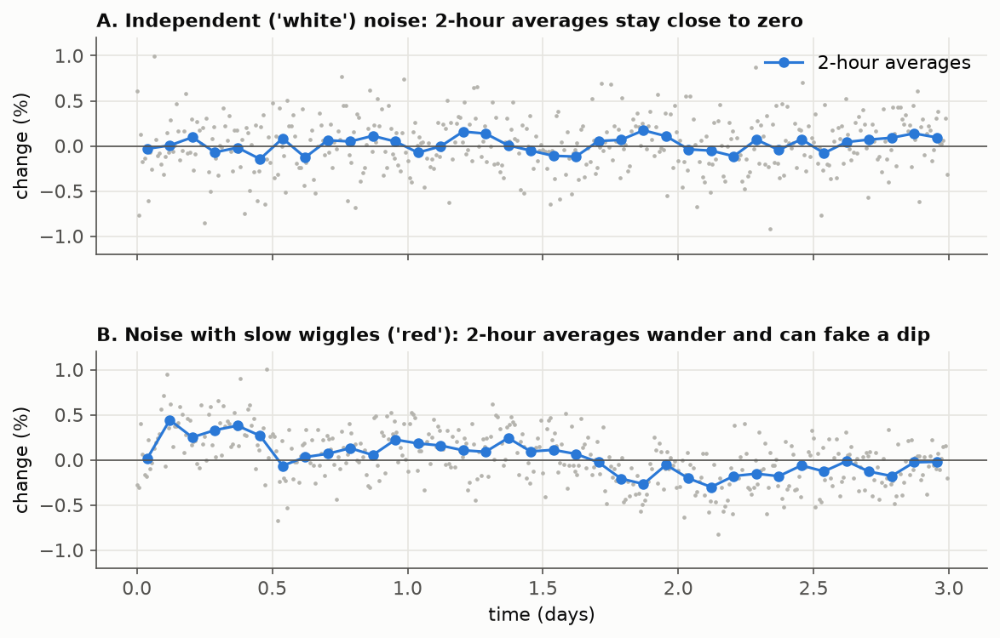

*Both have the same scatter from point to point. A: the 2-hour averages hug zero, as the √N
rule predicts. B: the averages wander by up to 0.3 %, because neighbouring measurements share
the same slow offset. A 2-hour stretch that happens to sit low looks just like a transit.*

Red noise is the reason real data are harder than textbook examples. We fight it in two ways:
we remove as much of the slow variation as possible before searching (article 3), and we
measure how much red noise is left around each candidate dip. That second, more honest
estimate is used to rank the candidates and to judge each dip individually (section 1.10,
impostor 6). The final yes/no significance cut still uses the textbook σ ÷ √N, combined with
a second score (section 1.9): fake planets hidden in real data showed that this combination
finds slightly more planets for the same number of false alarms.

---

## 1.7 Folding: stacking the dips on top of each other

Section 1.6 says we should average measurements taken *during* the dips. But in real data we
cannot see where the dips are. Here is what 27 days of a realistic star with a transiting
planet look like:

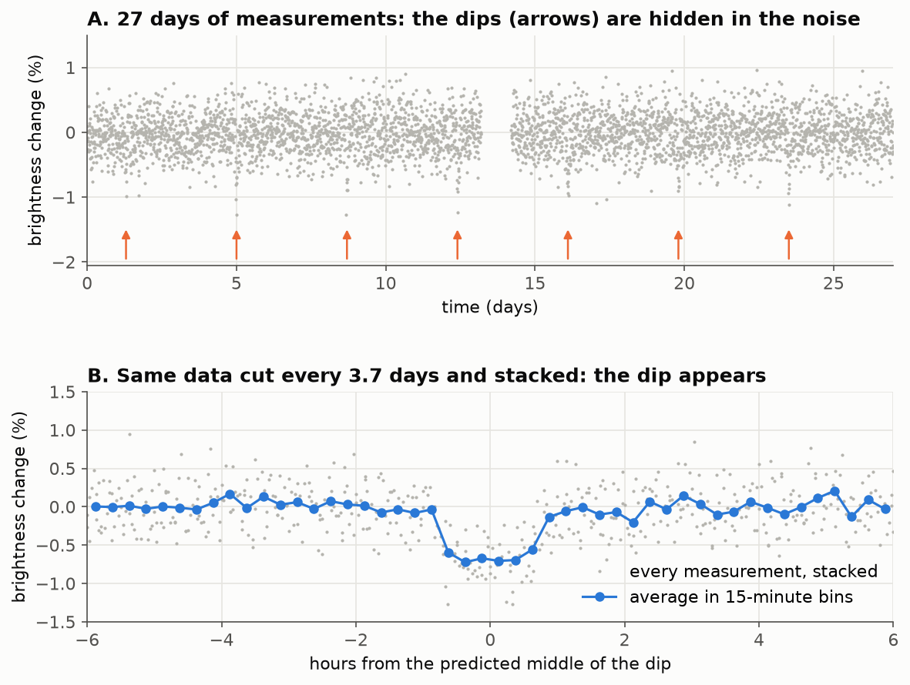

*A. Each grey dot is one measurement, every 10 minutes. The planet passes in front of the star
seven times (arrows), but the dips barely stand out from the noise. B. The same data after
"folding" at the right period: the dip is clear.*

Folding is how we gather the dips together without knowing where they are, as long as we
**guess the period**. It is easiest to understand on a tiny example.

### A toy example you can do by hand

Imagine a star measured once an hour for 24 hours. Its normal brightness is 100 (in some
unit), the noise is about ±1, and a planet makes a 1-hour dip of 3 every 6 hours, at hours
2, 8, 14 and 20. Here are the 24 measurements, written in rows of 6:

| hours | slot 0 | slot 1 | slot 2 | slot 3 | slot 4 | slot 5 |
|---|---|---|---|---|---|---|
| 0–5 | 100 | 101 | **98** | 100 | 100 | 100 |
| 6–11 | 100 | 100 | **98** | 99 | 101 | 100 |
| 12–17 | 101 | 100 | **97** | 100 | 101 | 100 |
| 18–23 | 100 | 101 | **96** | 99 | 100 | 99 |
| **average** | 100.25 | 100.5 | **97.25** | 99.5 | 100.5 | 99.75 |

Writing the data in rows of 6 is exactly what **folding with a period of 6 hours** means. We
cut the light curve into slices one period long and stack them. Because the dips repeat every
6 hours, every dip lands in the same column (slot 2). Averaging each column then does the
noise reduction of section 1.6 for us: the noise in the other columns cancels out to about
100, while slot 2 keeps its dip.

Now fold at the **wrong** period, 5 hours (rows of 5):

| hours | slot 0 | slot 1 | slot 2 | slot 3 | slot 4 |
|---|---|---|---|---|---|
| 0–4 | 100 | 101 | **98** | 100 | 100 |
| 5–9 | 100 | 100 | 100 | **98** | 99 |
| 10–14 | 101 | 100 | 101 | 100 | **97** |
| 15–19 | 100 | 101 | 100 | 100 | 101 |
| 20–23 | **96** | 99 | 100 | 99 | |
| **average** | 99.4 | 100.2 | 99.8 | 99.4 | 99.25 |

The dips now fall into different columns, each mixed with normal measurements, and every
average stays close to 100. Nothing stands out.

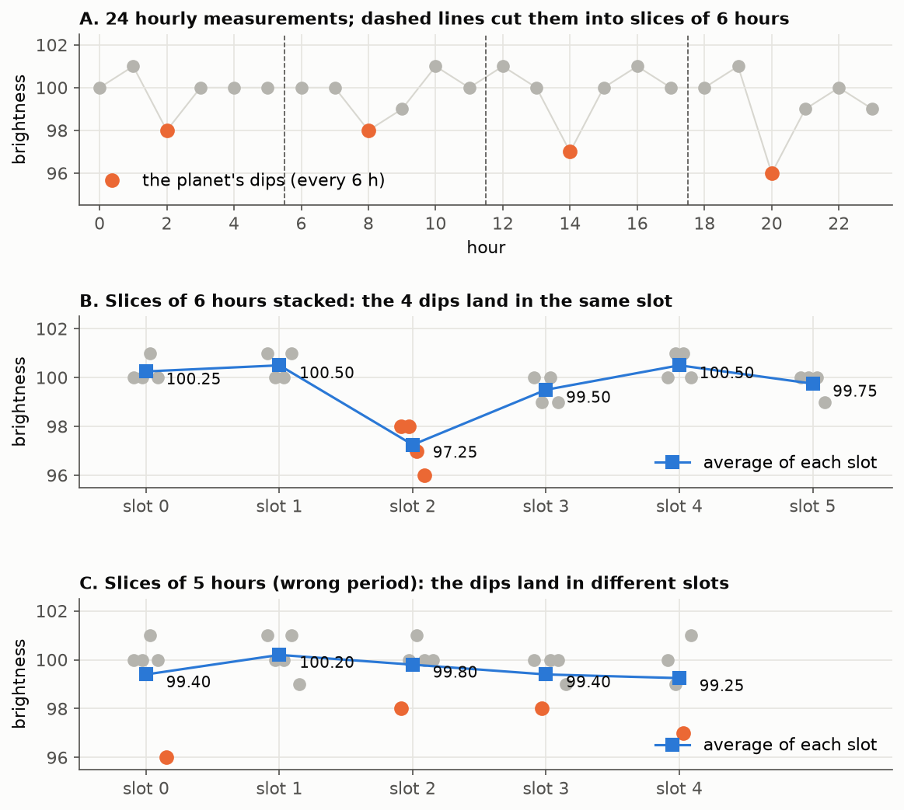

*The same toy data as the tables. Orange points are the dips. B: with the right period they
pile up in one slot. C: with a wrong period they spread out and the averages stay flat.*

### Two different lengths: the period and the bin

It is easy to mix up two lengths involved in folding:

- **The period** (6 hours in the toy, 3.7 days in the realistic example) is the **length of
  each slice**. It is the thing we are trying to guess. Only the right period makes the dips
  line up.
- **The bin** (1 hour in the toy, 15 minutes in panel B above) is the **width of each column**:
  how finely we chop a slice before averaging. The position inside a slice, from the start
  (0) to the end (1), is called the **phase**.

In the toy example the bins are simply the hourly measurements. In real data the period is not
a whole number of measurement intervals, so measurements from different slices fall at
slightly different phases. We group them into small bins and average each bin. The bin must
be **shorter than the dip**: if it were, say, 6 hours wide, a 2-hour dip would be averaged
together with 4 hours of normal measurements and would look three times shallower.

Folding also means each bin contains measurements from every slice: in panel B, each 15-minute
bin averages about 10 measurements (one or two from each of the seven slices), and the bins
inside the dip together hold the 84 in-dip measurements of section 1.6.

---

## 1.8 The search: trying every possible period

Folding works only if we know the period, and we don't. The solution is brute force: **try
every period, and keep the one that makes the deepest, most convincing dip.** This is the
search, and it is the same for every star.

### The algorithm

The computer compares the data with a very simple model of a planet, a **box**: the brightness
is constant, except during a short window that repeats every P days, where it is lower. The
box has three settings:

- **P**, the period (the length of the slices);
- **t₀**, the time of the first dip (where in the slice the dip sits);
- **d**, the duration (how wide the dip is).

The search goes through all combinations:

1. **For each trial period P** from 0.5 to 13 days:
   1. Fold the light curve at P (section 1.7).
   2. **For each position t₀** along the folded cycle, in small steps, **and each duration d**
      (1, 2 or 3 hours, say):
      - average the measurements that fall inside the box;
      - average the measurements outside it;
      - the difference is the box's **depth**, and from it we compute a **score**: how many
        times bigger the depth is than the noise could make it (this is the signal-to-noise
        ratio, defined precisely in section 1.9).
   3. Keep the best score for this period.
2. **Draw the best score against the trial period.** This graph is called a **periodogram**.
3. **The tallest peak is the best period**, and the box that produced it gives the time of the
   dips, their duration and their depth.

How many periods do we try? The trial periods must be close enough together that the right one
is not skipped. If our trial period is off by a little, the error grows with each slice: off
by 0.01 days, the seventh dip lands 0.07 days (1.7 hours) away from where the box expects it,
and is missed. Keeping that drift below a fraction of the dip duration takes about **24,000
trial periods** between 0.5 and 13 days. Times a few hundred positions and three durations,
that is tens of millions of boxes per star. It takes a computer a few seconds.

Here is the result on the star of section 1.7, and on a star with the same noise but no
planet:

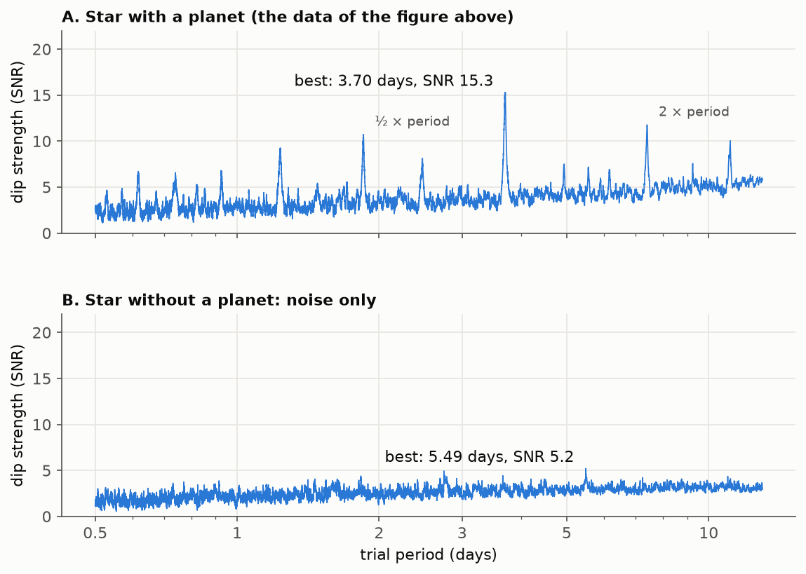

*A. The highest peak is at 3.70 days, the planet's period. The smaller peaks are echoes at
simple fractions and multiples of it (½, ⅓, 2, 3 times the period): at twice the period, for
example, every other dip still lines up. B. With no planet, the search **still returns a
"best" period**, here 5.49 days with a score of 5.2, because something has to be highest. It is
simply the luckiest combination of noise.*

Panel B is the reason for the next section. The search always produces an answer; the question
is whether that answer means anything.

The real pipeline uses a refined version of this idea called *Transit Least Squares*: instead
of a box it uses the real rounded transit shape of section 1.1, and it chooses the durations to
try from each star's size and mass (section 1.3). It also searches a slightly wider range of
periods than this toy version, from 0.2 days to half the length of each light curve. Article 4
covers it in detail.

---

## 1.9 How strong is strong enough?

### The signal-to-noise ratio

The score used by the search is the **signal-to-noise ratio (SNR)**: the depth of the dip
divided by the spread that noise alone would give to the average of the in-dip measurements.
From section 1.6, averaging n measurements gives a spread of σ ÷ √n, so:

> **SNR = depth ÷ (σ ÷ √n) = depth × √n ÷ σ**

where

- **depth** is the measured dip (the average outside the box minus the average inside it),
- **σ** is the spread of a single measurement,
- **n** is the total number of measurements inside the dips, all dips together.

In words: **how many noise-spreads deep is the dip?** It is the "dip = 18 spreads" of the
bottom panel of the averaging figure. Worked examples, with σ = 0.3 % and measurements every 10
minutes:

| case | depth | n | SNR |
|---|---|---|---|
| one measurement in a dip | 0.6 % | 1 | 0.6 × 1 ÷ 0.3 = 2 |
| one 2-hour dip | 0.6 % | 12 | 0.6 × 3.5 ÷ 0.3 = 6.9 |
| seven 2-hour dips (section 1.7's star) | 0.6 % | 84 | 0.6 × 9.2 ÷ 0.3 = 18 |
| Earth-size planet, period 1 day, 27 one-hour dips | 0.05 % | 162 | 0.05 × 12.7 ÷ 0.3 = 2.1 |

(The search found 15 for section 1.7's star rather than 18, because a box does not exactly
match the dip's sloping sides. The last line is the Earth-size planet of section 1.4: even with
27 dips it stays at SNR 2, lost in the noise.)

The formula shows the three ways to make a planet easier to find: a **deeper** dip (bigger
planet, smaller star), **more measurements in dips** (more transits, longer observations), and
**less noise** (brighter star).

### Why we need SNR of about 7, not 3

With the bell-curve table of section 1.6, an SNR of 3 looks convincing: noise alone produces a
3σ dip only 0.13 % of the time, 1 in 740. The catch is that **the search does not test one
box, it tests tens of millions of them**, and keeps the best. It is like buying lottery
tickets: the chance that one particular ticket wins is tiny, but buy enough and one will.

Many of those boxes overlap and are not really independent, but even counting conservatively
the search makes something like 100,000 independent tries per star. There is a handy rule of
thumb for the largest of M independent bell-curve values: it is at most about √(2 × ln M)
spreads (ln is the natural logarithm; the typical value is a few tenths lower, e.g. 3.2
instead of 3.7 for 1,000 tries):

| independent tries M | typical best score from pure noise |
|---|---|
| 1,000 | 3.7 |
| 100,000 (one star) | 4.8 |
| 10,000,000 | 5.7 |
| 1,000,000,000 (all our stars) | 6.4 |

We checked this directly: running the search on 100 simulated stars with no planet at all, the
best score in each star came out between 4.2 and 5.9, with a typical value of 4.9.

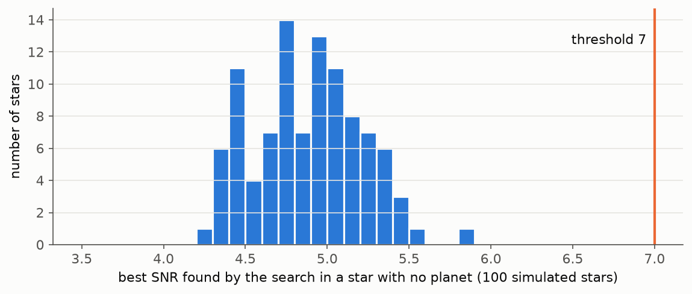

*Every one of these stars "has" a best period with a score near 5, and none of them has a
planet. Nothing reaches 7.*

So the threshold has to sit **above what the luckiest noise in thousands of stars can do**. An
SNR of about 7 does that on its own; a slightly lower SNR cut works if a second, independent
score is also required (see below). It is also why the scores in this business are judged with the
search in mind (this effect is called the *look-elsewhere effect*: the more places you look,
the more impressive a fluke you will find).

Two more practical points:

- **Red noise makes things worse.** Real light curves have leftover slow wiggles (section 1.6)
  that the bell-curve table does not account for. The pipeline therefore also estimates the
  noise near each candidate dip from the data themselves. This more honest SNR is used to rank
  candidates and to check the dips one by one; it can be several times lower than the textbook
  one for a signal made by instrument trouble.
- **A second score.** The pipeline also asks how much the tallest peak stands out from the
  rest of the periodogram (the *signal detection efficiency*, SDE). A real planet makes one
  peak tower over the others, as in panel A above; noise makes a forest of similar peaks, as
  in panel B. Our pipeline requires a textbook SNR ≥ 6.5 **and** SDE ≥ 10. An SNR of 6.5 alone
  would be borderline (the table above), but pure noise rarely clears both cuts at once.
  Article 8 explains how those exact numbers were chosen by hiding fake planets in real data
  and counting how many we find, and how many real (mostly false) signals get through.

A dip that passes these thresholds is called a **signal**. It is very unlikely to be pure
random noise. It can still be many other things.

---

## 1.10 Things that look like a planet but are not

Most signals are *not* planets. In our first run, about 4,700 stars were searched, and after
the checks of this section 13 new signals were left; none of them turned out to be a planet
we could report (section 1.13). Everything that mimics a planet is called a **false positive**. Here are
the main ones, from most to least common in our data.

### Impostor 1: the camera and the spacecraft

TESS is an extremely precise instrument, but it is not perfect. Its light curves contain:

- **Ramps**: after each data download the spacecraft re-points and its temperature settles,
  and near the Earth, light from the Earth and Moon scatters into the cameras. The measured
  brightness drifts for the first hours after each gap.
- **Steps and glitches**: the spacecraft regularly fires small thrusters to keep its
  pointing steady (*momentum dumps*). The pointing wobbles a little, and the brightness can
  jump or drop briefly.

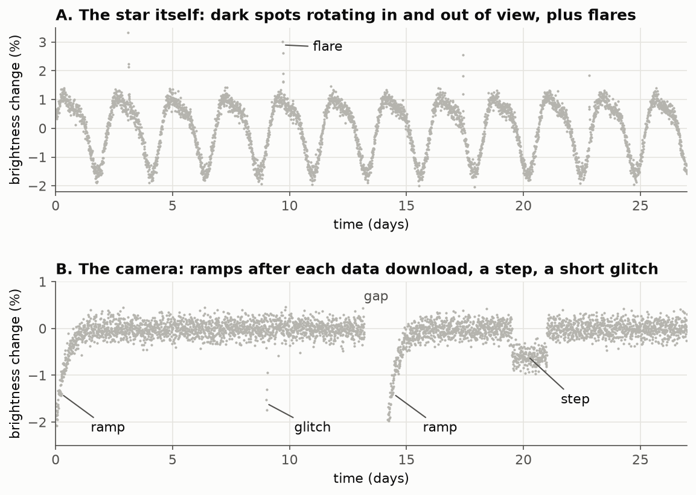

*A. A star whose spots rotate in and out of view, with a few flares. B. A perfectly constant
star as recorded by a camera with ramps, a step and a glitch.*

A ramp at the start of each half of the sector repeats every ~14 days. Two ramps look a lot
like two transits of a planet, and the search can also line them up at a fraction of that
spacing. In the first tests of this project it was the most common fake signal. These are also the red noise of section 1.6: many measurements in a row pushed the same
way, which the SNR formula would wrongly treat as independent.

**How we tell:** we know when the gaps and thruster firings happen. A dip that only appears
next to them, or appears only in the edges of the data, is suspicious. A real planet doesn't
know about the spacecraft's schedule: its dips land wherever its orbit puts them.

### Impostor 2: the star itself

Stars are not perfectly steady light bulbs.

- **Spots**: like the Sun, red dwarfs have dark spots. As the star rotates, spots come into
  and out of view, so the brightness goes up and down smoothly (panel A above). Red dwarfs
  are often much more spotted than the Sun, with variations of several percent: bigger than
  the planet dips we are looking for.
- **Flares**: sudden bursts of brightness lasting minutes. They go *up*, not down, so they
  cannot be transits, but they disturb the measurements around them.

**How we tell:** we remove the slow up-and-down variations before searching (this is called
*detrending* or *flattening*, and article 3 is about doing it without also erasing the
planet dips). Then, if the "planet" period turns out to match the star's own rhythm (the
same period, or a simple multiple or fraction of it), we don't trust it. We look for that
rhythm twice: in the flattened light curve, where only fast variations (hours) survive and a
match rejects the signal outright, and in the light curve *before* flattening, where the
slower rotation of a spotted star (days) is still visible. There a match is only shown on the
candidate's page for a human to judge: in TESS data, slow variations over days are mostly
caused by the instrument, so they match real planets' periods too often to reject anything. A
transit is short and sharp (an hour or two); spot variations are smooth.

### Impostor 3: two stars orbiting each other (eclipsing binaries)

About half of all Sun-like stars, and about a quarter of red dwarfs, have a companion star. If the two orbit each other and their orbit
is seen edge-on, they take turns passing in front of each other. This is an **eclipsing
binary**. It is the classic impostor.

#### Why a companion star makes dips, never bumps

A natural question: the companion is a star, it shines too. When it passes in front, shouldn't
the total brightness go *up* sometimes, for example when the brighter star is the one in front?

The answer is no, and the reason is what we actually measure:

1. **We cannot separate the two stars.** They are so close together and so far away that TESS
   (and most telescopes) sees them as a single point of light. We always measure **the sum of
   both**: light of A + light of B.
2. **The companion's light is always there.** Star B sends us its light whether it is beside,
   in front of, or behind star A, as long as nothing blocks it. So B's light is already part of
   the normal brightness, all the time. Moving in front of A does not make B any brighter; a
   star does not shine more because of where it is.
3. **The only thing that changes is blocking.** When one star is in front, it hides part of
   the other one. Some light that normally reaches us no longer does. The total **can only go
   down**.

So an eclipse is always a dip, whichever star is in front. (Between eclipses, a binary's total
light can wobble gently up and down: close stars are stretched into egg shapes and light up
each other's facing sides. Those are slow, smooth changes over the whole orbit, not short
bumps, and the variability checks of impostor 2 see them.) What changes is *which* light is
lost, and therefore how deep the dip is. Think of two lamps across a dark field: when one
passes behind the other, you lose the light of the hidden lamp; the front lamp does not get
brighter.

#### A worked example over one orbit

Take a big, hot star A and a smaller, cooler star B, half as wide (so a quarter of the area).
Being cooler, every bit of B's surface is also dimmer: say 4 times dimmer per unit of area.
In convenient units:

| | area of its disc | light per unit of area | total light |
|---|---|---|---|
| star A | 100 | 10 | 1,000 |
| star B | 25 | 4 | 100 |
| **together (what we measure)** | | | **1,100** |

Now follow one orbit:

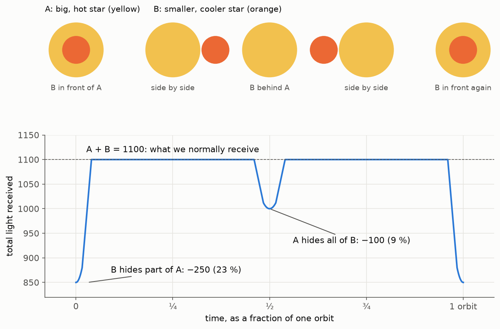

- **B in front of A.** B covers 25 units of A's area. Those 25 units of A sent 25 × 10 = 250.
  We lose 250: the total drops from 1,100 to 850, a **23 %** dip.
- **Side by side.** Nothing is hidden: 1,100.
- **B behind A.** A, the bigger star, hides all of B. We lose B's 100: the total drops to
  1,000, a **9 %** dip. This is the case the question was about: the brighter star is in front,
  and we still see a dip, because B's light disappears.
- **Side by side again**, then the cycle repeats.

The depth of each dip is **the area hidden × how bright that hidden surface is**. Both dips
here hide the same 25 units of area, but in one case the hidden surface belongs to the hot star
(bright per unit of area) and in the other to the cool one. So:

- The deeper dip happens when **the hotter star is hidden**.
- The second, shallower dip happens **exactly half an orbit later** (for circular orbits).

**And a planet?** A planet is just an extreme case of star B: it is so cold that its surface
sends almost no light. When it passes in front, we lose the patch of the star it covers (the
transit). When it goes behind, we lose its own light, which is nearly zero: no visible second
dip. That difference is what the tests below exploit.

#### How an eclipsing binary gives itself away

**a) A second dip halfway (the secondary eclipse).** If the search finds the true period, a
binary shows its main dip at phase 0 and a second, shallower one at phase ½. A planet shows
nothing at ½.

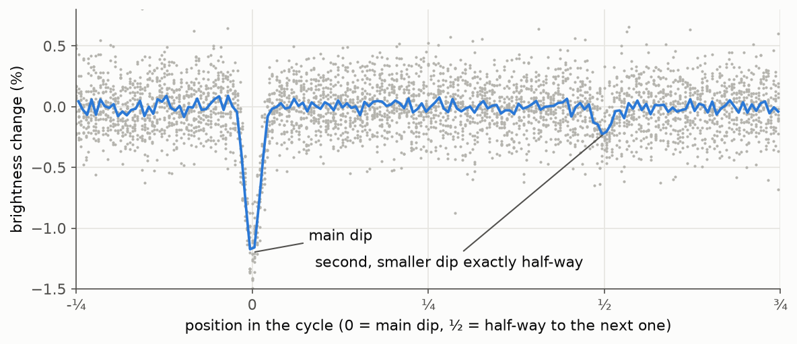

*After folding at the period, the main dip is at 0, and the next one would be at 1. The small
dip at ½ is the companion being hidden.*

**How we tell:** we look for any dip away from the main one. Near the halfway point a dip of 5
spreads is enough to reject the signal. Elsewhere we ask for 7 spreads: on an elongated orbit
the second eclipse can sit away from ½, but leftover noise on a bright star also makes
occasional 5-spread dips at random phases, and a 5-spread cut there rejected real planets.

**b) Every other dip is different (odd/even).** A binary has two dips per orbit, evenly spaced.
The search looks for *one* dip that repeats, so it often reports **half the true period**: it
sees "a dip every half-orbit" and mixes the deep and shallow ones together. In the light curve,
the dips then alternate: deep, shallow, deep, shallow.

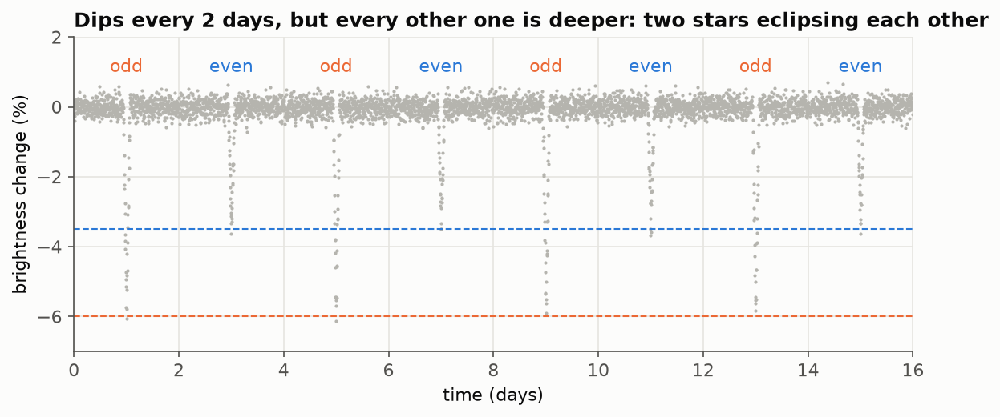

*Splitting the dips into odd (1st, 3rd, 5th, ...) and even (2nd, 4th, ...) shows two different
depths. A planet's dips would all be the same.*

**How we tell:** we measure the odd and the even dips separately. For a planet they must match.

**c) The dips are too deep.** With the formula of section 1.2, a 23 % dip means an object about
half as wide as the star. Planets are at most a little bigger than Jupiter; if the depth implies
an object more than about 1.5 times as wide as Jupiter, it is a star (around a red dwarf,
that is a dip of roughly 10–15 % or more).

**d) The shape is a V instead of a U.** When two stars only *graze* each other (the edge of
one just clips the edge of the other), there is never a moment when one is "fully in front".
The dip goes down and immediately up again. A planet, much smaller than its star, spends most
of the transit fully inside the star's disc, which gives the steep sides and wide bottom of
section 1.1.

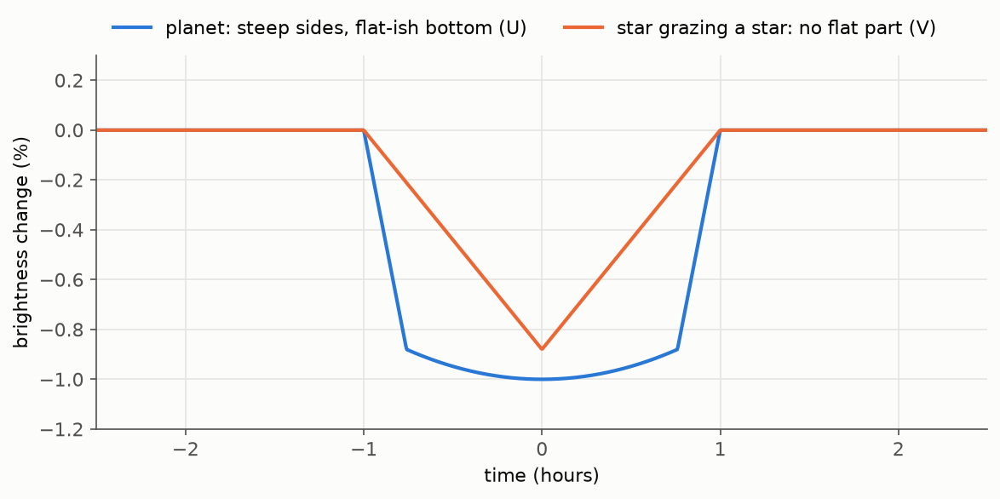

*Same depth and duration, different shapes. A planet whose orbit only clips the edge of the
star can also give a V, so a V shape is a warning, not a verdict.*

**How we tell:** we fit both shapes and see which one matches the data.

(If the two stars are identical twins, both dips are equal and tests a and b see nothing. Such
systems are still caught by c, d, or the duration test of impostor 5, because a star-sized
companion makes long, deep, V-shaped eclipses.)

### Impostor 4: someone else's eclipse (blends)

This one is subtle and very common in our data.

#### What the camera actually sees

A TESS pixel is big: it covers a patch of sky 21 arcseconds wide, the apparent size of a coin
seen from about 230 metres. On top of that, each star's light is spread over a few pixels.
So the patch of sky that we call "our star" usually contains other, fainter stars too: some
next to it, some thousands of light-years behind it, unrelated to it, just in the same
direction.

To build a light curve, the software adds up the light in a small group of pixels around our
star (the orange box in the figure below). Whatever light from other stars falls in that box is
included.

#### Why a faint neighbour can fake a planet

Same logic as the eclipsing binary: the neighbour's light is always included, so it is part of
the normal brightness and never makes bumps. But if the neighbour is itself an eclipsing
binary, its dips are passed on to our measurement, **diluted** by our star's light.

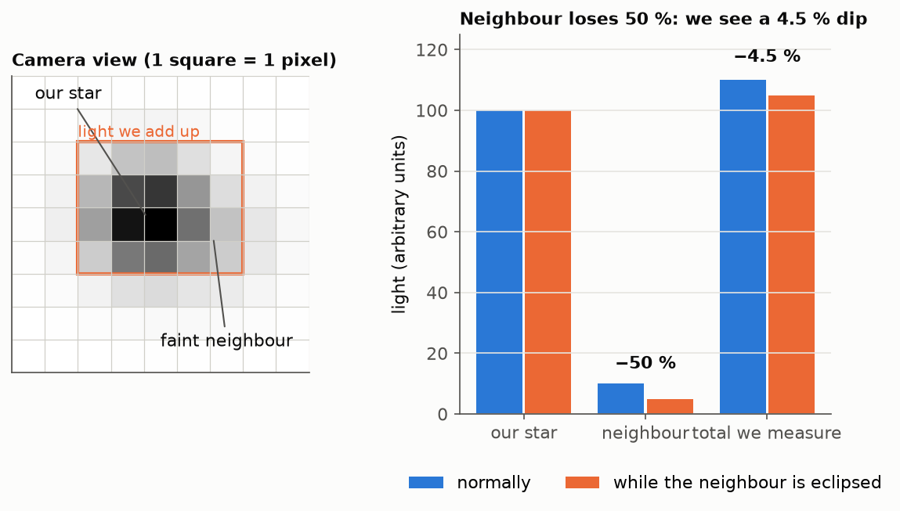

*Left: the camera sees two stars in the same few pixels, and we add up all the light inside
the orange box. Right: the neighbour loses half its light in an eclipse. Our measurement only
drops by 4.5 %, a perfectly planet-like depth.*

In numbers: our star contributes 100, the neighbour 10, so we normally measure 110. The
neighbour's eclipse removes half of *its* light, 5 units. We see 110 → 105, a dip of
5 ÷ 110 = 4.5 %. In general:

> **dip we measure = the neighbour's own dip × (neighbour's light ÷ total light)**

The fainter the neighbour, the more its eclipse is diluted, and the more planet-like it looks.
A neighbour 100 times fainter than our star with a 30 % eclipse gives 30 % ÷ 101 ≈ 0.3 %: just
what a planet about 2½ times as wide as the Earth would do around our typical red dwarf. Since faint stars are everywhere, this is a real problem.

(The same dilution also works the other way: if our star really has a planet, the neighbours'
light makes its dip look shallower than it is, and the planet smaller. The light-curve producers
correct for this: they subtract the light that star catalogues predict for the neighbours, and
divide by our star's light alone. In those *deblended* light curves a neighbour's eclipse
shows up as its own dip × (neighbour's light ÷ our star's light), slightly deeper than the
formula above. The pipeline uses that version.)

#### How we tell where the light was lost

**The centre of light moves.** Besides the total brightness, we can measure *where* in the
pixel box the light is centred: the average position of the light, each position weighted by
how much light comes from it. Put our star at position 0 and the neighbour 2 pixels to its
right:

> centre of light = (0 × light of our star + 2 × light of neighbour) ÷ total light

| situation | our star | neighbour | centre of light |
|---|---|---|---|
| normal | 100 | 10 | 20 ÷ 110 = 0.182 pixels |
| neighbour in eclipse (blend) | 100 | 5 | 10 ÷ 105 = 0.095: moves **0.087 towards our star** |
| our star has a 4.5 % transit | 95 | 10 | 20 ÷ 105 = 0.190: moves **0.009 towards the neighbour** |

Both cases give the same 4.5 % dip in the total, but the centre of light moves in **opposite
directions**, and the blend moves it **10 times more**. If the centre of light jumps away from
the neighbour during every dip, the neighbour is the culprit. This is called a **centroid
shift**. Real shifts are small (hundredths of a pixel or less) and noisy, so we again ask
whether the shift is several spreads bigger than its noise.

**Which pixels lose light.** Going further, we can subtract the average picture taken outside
the dips from the average picture taken during the dips. The pixels that lost light light up
in this *difference image*, and they sit on the star that is really dimming (article 9).
With only a few dips, noise alone can make some pixel look as if it lost light, so we also
build the same picture at many times when no dip is expected. A pixel counts only if it loses
more light than any of those fake dips manage to show by chance.

**Is there a suspicious neighbour?** Star catalogues (mainly from the Gaia satellite) list
every star near ours, with its brightness. Using the dilution formula backwards, we can ask:
could this neighbour, even if it disappeared completely, produce a dip this deep? (At most it
removes its own light: a dip of neighbour's light ÷ our star's light, in a deblended light
curve.) If not, it is
innocent. If a neighbour is a *known* eclipsing binary with the same period, our signal is
almost certainly its eclipse. With a different period it is innocent, unless our period is an
exact whole multiple of its period. A binary that eclipses every 0.32 days would put a dip in our
light curve every 0.32 days, not one every 5.69 days. 5.69 days is 18.006 times 0.32 days, and
that leftover 0.006 adds up: after six years of orbits the eclipses have drifted most of a day
away from our dips.

In our first run, this was the most common impostor among the signals that passed every
automatic check: 7 of the 13.

### Impostor 5: a dip that does not match the star

Section 1.3 showed that the duration of a transit is fixed by the period and the star's size
and mass. Around a star 40 % the size and mass of the Sun, a planet with a 3-day period should
take about **1.4 hours** to cross the middle of the star. It can take less if it crosses
closer to the edge, but it cannot take much more.

If we see a 3-day signal on that star where each dip lasts 10 hours, something is wrong: the
dip probably comes from a different, larger star (a blend), the companion is a star itself, or
the catalogue size of our star is wrong.

**How we tell:** we compare the measured duration with the expected one. A dip more than 1.5
times longer than a central transit is rejected; that margin covers elongated orbits and
catalogue errors. A shorter dip is always allowed. In our first run, the known planets came
out at 0.5 to 0.9 times the central-transit duration, and the signals that passed with 1.5 to
2.3 times turned out to be blends and eclipsing binaries.

### Impostor 6: bad luck

Sometimes noise, a glitch or a flare happens to line up at a regular interval, or a single
event dominates the fold. Examples from our run:

- A signal with ten predicted dips where the first seven showed nothing and each of the last
  three contained a short burst of noisy measurements. Averaged together, the bursts looked
  like a dip. A planet would have produced all ten dips equally, so the pipeline now checks
  that the signal survives when the most suspicious dips are removed.
- A signal that looked perfect in one sector but was absent in **nine other sectors** of
  the same star, where a dip that deep would have been obvious. Real planets don't switch off.

**How we tell:** check that the dips are individually consistent, and that the signal comes
back in other observations of the same star. Only observations good enough to show it count
against it: we first compute how strong the signal *would* be in each other sector (its noise,
its number of measurements). A sector where even a real planet would hide in the noise proves
nothing either way.

---

## 1.11 Already known?

Even a perfect planet signal is not what we want if someone has already found it. TESS data
are public and many teams search them. So the last filter compares each signal with
published lists: confirmed planets, *TESS Objects of Interest* (the official TESS candidate
list), candidates submitted by the community, and catalogues of known eclipsing binaries. A
match means "not new", and also tells us the pipeline works: in our first sector, the search
found all 9 confirmed transiting planets among our stars, at the right periods. Eight of them
also passed every automatic check; the ninth, TOI-122 b, missed the SNR cut (5.6 instead of
6.5), the price of a threshold that keeps the false alarms manageable.

---

## 1.12 Portrait of a likely planet

Putting it all together, a signal is a good planet **candidate** when, in the light of its
star:

| | the signal ... | rules out | section |
|---|---|---|---|
| A | is a **dip** (a dimming, not a brightening) that **repeats at a perfectly regular interval**, at least twice and preferably many times | noise, flares, single glitches | 1.7, 1.8 |
| B | stands **clearly above the noise** (SNR ≥ 6.5 together with a periodogram peak that towers over the rest) | chance alignments of noise | 1.9 |
| C | is made of **dips that all look alike**: none dominates, and odd and even dips have the same depth | bad luck, eclipsing binaries at half the period | 1.10 |
| D | has **nothing halfway** between the dips (nor a strong dip anywhere else) | eclipsing binaries | 1.10 |
| E | has a **steep-sided, wide-bottomed (U) shape** | grazing eclipsing binaries | 1.10 |
| F | has a **depth that implies a planet-sized object** (from Earth-size up to Jupiter-size) | eclipsing binaries, small stars | 1.2 |
| G | has a **duration no longer than what a planet around this star at this period can take** | blends, wrong star | 1.3 |
| H | **ignores the spacecraft's schedule**: dips are not tied to gaps, ramps or thruster firings | instrument artefacts | 1.10 |
| I | **ignores the star's own rhythm**: the period is not the period of the star's variability or rotation, nor a simple multiple or fraction of it | spots, stellar variability | 1.10 |
| J | **comes from our star**: the light centre moves no more than an on-target dip would make it, and no neighbour can explain them | blends with neighbouring stars | 1.10 |
| K | **comes back** in every other observation of the same star (other TESS sectors) good enough to show it | one-off flukes, systematics | 1.10 |
| L | is **not already listed** as a planet, candidate or eclipsing binary | known objects | 1.11 |

A to I are computed automatically for every star; for E (shape) and the rotation part of I a
failure is only a warning for the human reader, not a rejection. J and K are partly automatic and partly done by
hand on the few signals that pass everything else. L is a lookup.

### What a candidate is *not*

Passing all of this makes a signal a **planet candidate**, not a confirmed planet. Two
limitations remain that light curves alone cannot fully remove:

- **Size is not mass.** A brown dwarf (a "failed star") or a very small star can be exactly
  the size of Jupiter. Only a measurement of the object's mass, made with other telescopes
  (for example by detecting the tiny wobble the planet causes in its star's motion), can settle
  that. For small candidates (a few Earth sizes), this confusion does not arise: no star is that
  small, apart from white dwarfs (dead stars the size of the Earth), which are rare
  companions and usually give themselves away with a deep second eclipse.
- **Some blends are invisible.** A faint eclipsing binary almost exactly behind our star, too
  close to separate even in the best catalogues, can pass every test. What we can do is
  estimate the **probability** that the signal is a false positive given everything we know
  (article 9 explains how).

The realistic outcome of this project is therefore a short list of strong candidates, checked
as far as public data allow, that can be submitted to the community list of TESS candidates so
that teams with larger telescopes can confirm or reject them.

---

## 1.13 From the "what" to the "how"

Each question above is answered by one stage of the pipeline. The following articles go
through them in order:

| stage | question it answers | code | hands-on notebook |
|---|---|---|---|
| 1. Targets | Which stars do we look at, and why these? | [src/targets.py](../../src/targets.py) | [notebook 1](../../notebooks/pipeline-1-targets-walkthrough.ipynb) |
| 2. Fetch | Where do the light curves come from, and which measurements can we trust? | [src/fetch.py](../../src/fetch.py) | [notebook 2](../../notebooks/pipeline-2-fetch-walkthrough.ipynb) |
| 3. Detrend | How do we remove the star's slow variations and the camera's ramps (the red noise) without erasing the dips? | [src/detrend.py](../../src/detrend.py) | [notebook 3](../../notebooks/pipeline-3-detrend-walkthrough.ipynb) |
| 4. Search | The search of section 1.8, done properly with realistic transit shapes | [src/search.py](../../src/search.py) | [notebook 4](../../notebooks/pipeline-4-search-walkthrough.ipynb) |
| 5. Vet | How are checks A to I computed automatically? | [src/vet.py](../../src/vet.py) | [notebook 5](../../notebooks/pipeline-5-vet-walkthrough.ipynb) |
| 6. Known | Is it already known, and is a known neighbour responsible? (check L, part of J) | [src/known.py](../../src/known.py) | [notebook 6](../../notebooks/pipeline-6-known-walkthrough.ipynb) |
| 7. Report | How do we look at a candidate by eye? | [src/report.py](../../src/report.py) | [notebook 7](../../notebooks/pipeline-7-report-walkthrough.ipynb) |
| 8. Calibration | Would we have noticed a real planet? How strict should the thresholds of section 1.9 be? | [src/inject.py](../../src/inject.py) | [notebook 8](../../notebooks/pipeline-8-injection-recovery.ipynb) |
| 9. Follow-up | Does it repeat in other sectors (K)? Which pixels dim (J)? What is the chance it's a false positive? | [src/followup.py](../../src/followup.py) | [notebook 9](../../notebooks/pipeline-9-candidate-followup.ipynb) |
| 10. Automatic follow-up | How does the pipeline run stage 9 on every surviving signal by itself and give each one a verdict? | [src/followup.py](../../src/followup.py), [src/cli.py](../../src/cli.py) | [notebook 10](../../notebooks/pipeline-10-automated-followup.ipynb) |

### What happened on the first run

As a concrete picture of the funnel, here is the first full run of the pipeline, on TESS
sector 104 (details in [PLAN_milestone1.md](../PLAN_milestone1.md) and
[REVIEW_sector104.md](../REVIEW_sector104.md)):

1. **4,710** nearby red dwarfs were in the part of the sky TESS observed.
2. **4,695** light curves were downloaded (15 downloads failed), and **4,693** were searched.
3. All **9** already-confirmed transiting planets around these stars were found by the
   search; **8** of them also passed every automatic check.
4. After the automatic checks and removing what was already known, **13** new signals remained.
5. Every one of the 13 then went through the other-sectors check (K) and the pixel check (J)
   automatically. **7** are eclipsing binaries or other blends on neighbouring stars, and **5**
   never came back in the other sectors that could have shown them (one of them was the
   pipeline's top-ranked signal, and two had already looked like glitches by eye).
6. **1** is left, TIC 214311908: a dip 4.9 times as wide as the Earth that comes back over six
   years and has the right duration and shape for this star. Its neighbours were checked one
   by one:
   - **The bright neighbours are ruled out.** Modelling how each star's light spreads over the
     TESS pixels excludes a companion star 12 arcseconds away, a giant star 18 arcseconds away,
     and every other star farther than about 6 arcseconds.
   - **Three faint stars within 6 arcseconds** are too close for the pixels to separate
     cleanly. Each would have to lose between a third of its light and nearly all of it to make
     the dip. The dip's flat-bottomed shape argues against that, for the closest one at roughly
     3.5σ.
   - **Nobody has looked at this star before.** The community databases list no earlier
     observations of it.
   - **The two eclipsing binaries catalogued within an arcminute are innocent.** They are far
     too faint to make the dip, and they eclipse at the wrong rhythm, every 0.32 and 0.26 days.

   The false-positive probability is about 0.1 once the stars ruled out by the pixels are
   dropped, and 0.45 if they are not. Both are below the 0.5 we set as the bar for reporting a
   candidate. Neither is low enough to call it a planet: observations from the ground, with
   images sharp enough to separate the stars, are still needed. A draft report for the TESS
   community list is in [docs/ctoi/](../ctoi/TIC214311908/CTOI_notes.md).

So no new planet yet, but one good candidate. That is the normal outcome of a search like this, and each run makes the
checks better. The pipeline's job is to make sure that when a real one is there, it reaches the
top of the list, and that we can say *why* each of the others is not a planet.

---

## Glossary

| term | meaning |
|---|---|
| **exoplanet** | a planet orbiting a star other than the Sun |
| **transit** | a planet passing in front of its star, as seen from Earth |
| **light curve** | a graph (or table) of a star's measured brightness over time |
| **depth** | how much the star dims during a transit, as a fraction of its normal brightness |
| **duration** | how long one transit lasts |
| **period** | the time between two transits, which is the planet's orbital period |
| **ppm** | parts per million; 1 % = 10,000 ppm. Depths are often quoted in ppm. |
| **noise** | the random error in each measurement |
| **σ (spread, standard deviation)** | the typical size of the noise; about 68 % of measurements fall within ±σ of the truth |
| **white / red noise** | errors independent from one measurement to the next / slow variations shared by many measurements in a row |
| **folding** | cutting a light curve into slices one period long and stacking them |
| **phase** | the position inside one period, from 0 to 1 |
| **bin** | a small window of phase whose measurements are averaged together |
| **periodogram** | a graph of the search's best score against the trial period |
| **SNR** | signal-to-noise ratio: depth × √(number of in-dip measurements) ÷ σ, i.e. how many noise-spreads deep the dip is |
| **SDE** | signal detection efficiency: how much the tallest periodogram peak stands out from the others |
| **look-elsewhere effect** | the more combinations a search tries, the bigger the flukes it finds by chance |
| **red dwarf / M dwarf** | a small, cool, dim star; the most common kind in our neighbourhood |
| **TESS** | NASA's Transiting Exoplanet Survey Satellite, which provides our data |
| **sector** | one ~27-day stretch during which TESS stares at one strip of sky |
| **TIC** | the TESS Input Catalog; every star has a TIC number, used as its name in this project |
| **false positive** | a signal that looks like a planet but is something else |
| **eclipsing binary** | two stars orbiting each other and taking turns hiding each other |
| **secondary eclipse** | the dip when the companion goes *behind* the star, half an orbit after the main dip |
| **blend** | when light from another star mixes with our star's light |
| **dilution** | a dip becoming shallower because extra, unaffected light is added to the measurement |
| **centroid shift** | movement of the centre of light during a dip, a sign of a blend |
| **candidate** | a signal that passed every check we can do; not yet a confirmed planet |
| **false-positive probability (FPP)** | the chance, given the light curve, the star and its neighbours, that the dip is caused by something other than a planet on our star; computed with the TRICERATOPS program |
| **TOI / CTOI** | TESS Object of Interest (official candidate list) / Community TOI (candidates submitted by anyone) |

*Figures: synthetic data drawn by [figures/make_figures.py](figures/make_figures.py), which
you can re-run and modify (`uv run python docs/primer/figures/make_figures.py`). The script also
prints every number quoted in this article that it computes: probabilities, durations, the
toy-example averages and the search results.*
